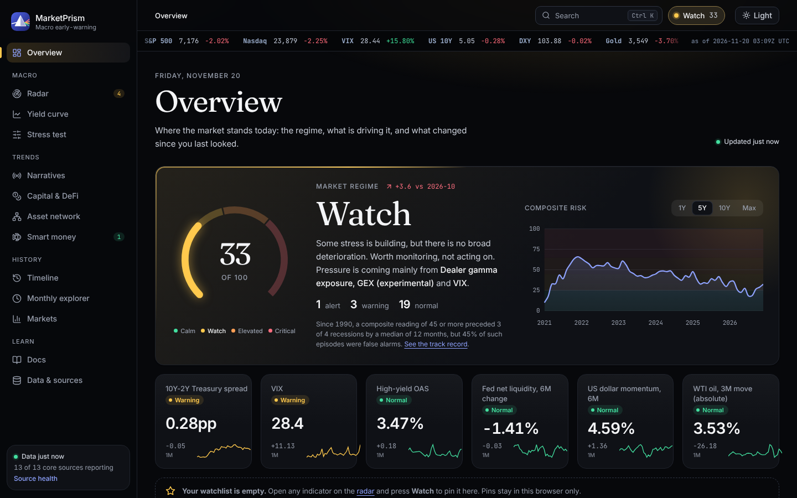
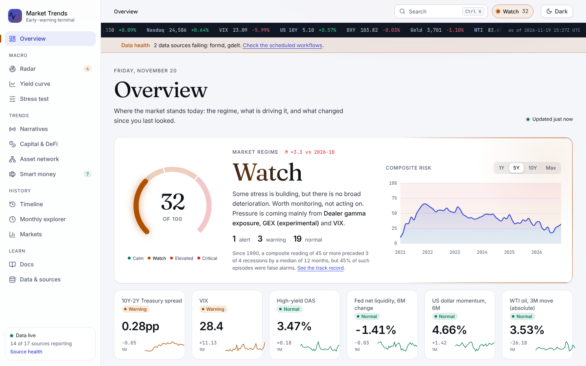
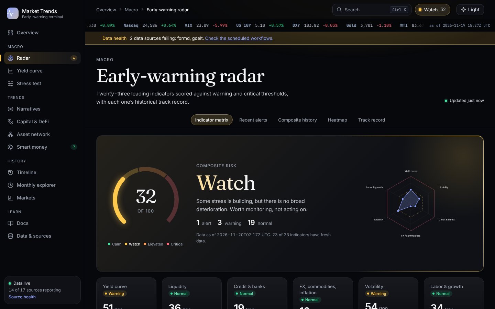
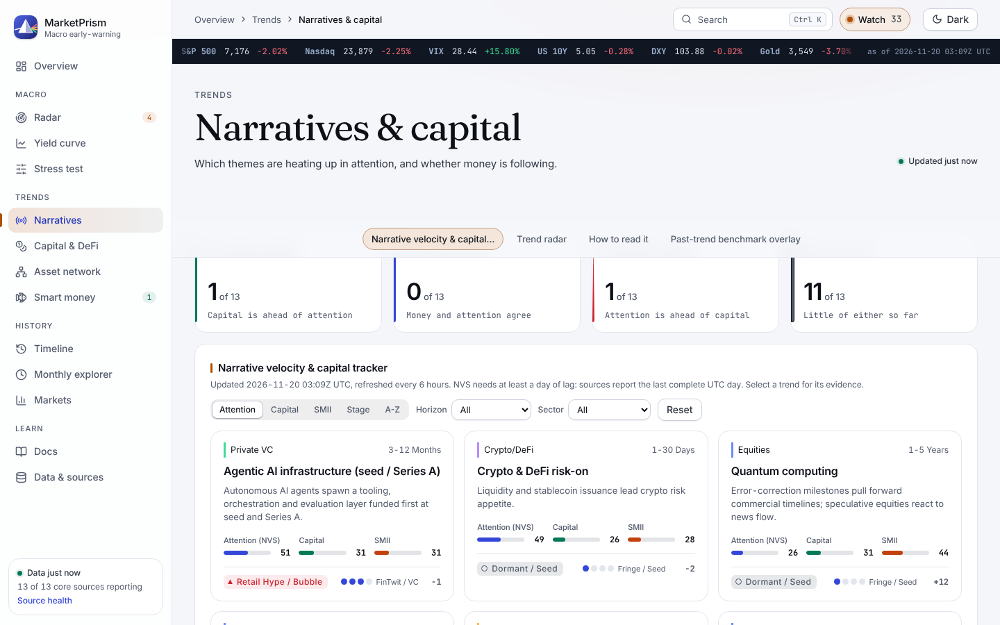

# MarketPrism

**An early-warning dashboard for the macro cycle, a radar for speculative trends, and 100 years of market history, in one static site.**

[](https://github.com/Jackpison/Market-Trends/actions/workflows/ci.yml)
[](https://github.com/Jackpison/Market-Trends/actions/workflows/fetch-data.yml)
[](https://github.com/Jackpison/Market-Trends/actions/workflows/update_trends.yml)
[](https://github.com/Jackpison/Market-Trends/actions/workflows/alerts.yml)
[](https://github.com/Jackpison/Market-Trends/actions/workflows/watchdog.yml)

Live site: **https://jackpison.github.io/Market-Trends/**

> Research and education only. Not financial advice. Indicator thresholds are heuristics, historical text is curated, and every figure should be checked against primary sources before you rely on it.



| Light theme | Radar | Trends |
|---|---|---|
|  |  |  |

## What it does

| Area | What you get |
|---|---|
| **Overview** | Composite risk gauge and regime (Calm, Watch, Elevated, Critical), what is driving it, 5-year composite chart with regime bands, key indicator tiles, risk by area, yield-curve comparison, trend radar, recent changes, and your own watchlist |
| **Radar** | 23 leading indicators scored against warning and critical thresholds, a filterable matrix, a detail drawer for each indicator (logic, thresholds, history, sources), a 15-year heatmap and a backtested track record against recessions and bear markets |
| **Yield curve** | Month-end Treasury curves since 1990 with a scrubber, inversion and steepening markers |
| **Stress test** | Inflation, rates, oil and credit shocks with modelled impact and its uncertainty |
| **Trends** | Narrative velocity vs capital backing for 13 themes, a Smart Money Inflow Index, DeFi liquidity, VC clusters, an asset-propagation network, a smart-money signal stream and a past-cycle overlay |
| **History** | A year-by-year timeline from 1926 with a 500-1000 character summary for every year and key numbers computed from market data, a monthly explorer and long-run market charts |
| **Alerts** | Regime changes, indicators turning red and trend quadrant moves, logged to `data/alerts.json`, published as an Atom feed and raised as GitHub issues |

### Indicators (23)
- **Yield curve:** 10Y-3M and 10Y-2Y Treasury spreads
- **Liquidity:** Fed net liquidity, M2 growth
- **Credit and banks:** high-yield OAS, investment-grade OAS, Baa spread, St. Louis Fed stress index, Chicago Fed financial conditions (NFCI), bank lending standards (SLOOS), regional banks (KRE)
- **FX, commodities, inflation:** dollar momentum, copper/gold ratio, WTI oil, 10Y breakeven inflation
- **Volatility:** VIX, MOVE, CBOE SKEW, dealer gamma (experimental, unscored)
- **Labor and growth:** Sahm rule, initial jobless claims, consumer sentiment, building permits

## Interface

- **Sidebar shell** with grouped pages, live badges and a data-freshness card; a bottom dock and slide-in drawer on phones.
- **Command palette** (`Ctrl/Cmd+K` or `/`) searches pages, indicators and trends.
- **Keyboard shortcuts:** `g` then `o` `r` `y` `s` `n` `c` `m` `h` to jump between pages, `t` toggles the theme, `?` lists them all.
- **Watchlist:** pin indicators from the radar drawer; they appear on the Overview (kept in your browser only).
- **Regime-reactive colour:** the ambient glow, gauge and highlights follow the current regime.
- **Motion with restraint:** pointer spotlight on cards, an animated border on the hero card, shimmer on the regime word, a circular reveal when switching theme, and scroll progress. All of it switches off under `prefers-reduced-motion`.
- **Round 2 touches:** KPI numbers tick up briefly on load (the final text is always the true value), pill and sidebar navs have a sliding indicator, the "What changed" feed staggers in, toasts show time left, pause on hover, swipe away and offer Undo, line charts show a hover dot, empty states explain what to do next, the phone dock slides away while you scroll down, and a four-step first-run tour appears once (replay it from the command palette: "Take the quick tour").
- **Accessible by default:** every status has a label and a shape (never colour alone), text meets WCAG AA in both themes (enforced by `tests/check_contrast.py`), drawers and dialogs move focus in and restore it on close, and there is a skip link.

Design notes: tokens live in `css/theme.css` (dark and light, hex values so charts can append alpha). Display type is Fraunces, body type is Inter, numerals are tabular, icons are an inlined Lucide subset. Fonts and libraries are vendored, so the site makes no third-party requests. Component conventions follow the public documentation of the [AlignUI](https://www.alignui.com/) design system, and interaction ideas (spotlight cards, border beam, shimmer text, animated theme toggle, dock, command palette) are inspired by patterns showcased on [21st.dev](https://21st.dev/), [React Bits](https://reactbits.dev/), [Magic UI](https://magicui.design/), [Uiverse](https://uiverse.io/), [Mobbin](https://mobbin.com/discover/) and [Aceternity UI](https://ui.aceternity.com/). Everything here is an independent vanilla CSS/JS implementation: no code or assets were copied and the project is not affiliated with any of them.

## Data sources

All free, all fetched by GitHub Actions on a schedule.

| Source | Used for |
|---|---|
| FRED (St. Louis Fed) | Treasury yields, spreads, liquidity, financial conditions, claims, sentiment, permits, bank lending standards |
| Yahoo Finance | Equity, volatility, commodity and FX series, ticker, options skew, 13F holder changes |
| DefiLlama | DeFi TVL, stablecoin supply, DEX volume |
| Hacker News, GitHub, arXiv, Wikipedia, GDELT, SEC EDGAR (filing mentions, Form D) | Narrative velocity per trend |
| Y Combinator directory | Early-stage VC clusters |
| Reddit (optional) | Extra narrative source; add `REDDIT_CLIENT_ID` and `REDDIT_CLIENT_SECRET` repo secrets |
| NBER recession dates (via FRED) | Backtest targets |

## Automation

| Workflow | When | What |
|---|---|---|
| **Data · macro indicators** (`fetch-data.yml`) | Weekdays, after the US close | Fetch FRED and market series, score indicators, build heatmap, yield curve, stress betas and the backtest; validates, then commits |
| **Data · trend signals** (`update_trends.yml`) | Every 6 hours | Score narratives, capital flows, smart-money signals and DeFi; validates, then commits |
| **Alerts · regime and trend changes** (`alerts.yml`) | After either data run | Single writer for `alerts.json` and `feed.xml`; quadrant alerts need two consecutive runs and a 48 hour cooldown, and experimental indicators never open an issue |
| **CI · tests and checks** (`ci.yml`) | Pull requests, pushes to `main` | Workflow lint, Python tests (alerts, watchdog, pipeline), data validation, WCAG contrast gate, browser smoke test over every page, theme and viewport; on pull requests also builds the single-file site and attaches it as a preview artifact |
| **Watchdog · data freshness** (`watchdog.yml`) | Every 6 hours | Opens one issue while data is stale and closes it when fresh |
| **Release · single-file snapshot** (`release-single.yml`) | Weekdays | Publishes `market-trends.html`, the whole site in one offline file |

Each data run writes a job summary (regime, warnings, source health) to the Actions page.

## Run it locally

```bash
python3 -m http.server                 # then open http://localhost:8000   (no build step)

python3 scripts/fetch_market_data.py   # long-history monthly series
python3 scripts/fetch_macro.py         # daily macro series (FRED, Yahoo)
python3 scripts/build_indicators.py    # indicators, heatmap, yield curve, stress betas
python3 scripts/backtest.py            # track record -> data/indicators/backtest.json
python3 scripts/fetch_trends.py        # trend signals -> data/macro_data.json
python3 scripts/alerts.py              # change log and feed
python3 scripts/build_yearly.py        # rebuild data/yearly/overview.json (summaries + computed metrics)
python3 scripts/build_single.py        # one-file offline build -> dist/ (needs Node for esbuild)
```

Tests:

```bash
python3 tests/test_pipeline_fixes.py   # offline tests for source health
python3 tests/test_alerts.py           # alert detection, debouncing, unscored indicators
python3 tests/test_watchdog.py         # data-freshness watchdog
python3 tests/check_workflows.py       # workflow lint (needs pyyaml)
python3 tests/validate_data.py         # structure of every data/config file the site reads
python3 tests/check_contrast.py        # WCAG AA gate for css/theme.css
node tests/smoke.mjs http://localhost:8000/index.html   # browser smoke test (needs playwright and a running server)
TRENDS_OUT=/tmp/t/data python3 tests/selftest_trends.py # always set TRENDS_OUT, or it overwrites data/
```

## Layout

```
index.html            single page; every view is a <section id="view-...">
css/                  base.css (legacy views) · terminal.css · trends.css · theme.css (tokens, shell, components; loaded last)
js/                   main.js boots everything; shell, palette, shortcuts, secnav, fx, watch, pages (navigation metadata), legacy.js (history/markets/learn)
  widgets/            one module per page: overview, earlyWarning, yieldCurve, stressTest, narratives, capitalFlows, network, smartMoney, ticker
  charts/             SVG chart helpers (gauge, radar, heatmap, line, yield, spark)
vendor/               Chart.js, vis-network, fonts, licences (no third-party requests at runtime)
config/               indicators.json (generated from scripts/_indicator_defs.py), trends.json, network.json
scripts/              data pipeline: fetch_*.py, build_*.py, backtest.py, alerts.py (+ _*defs, _years and _year_summaries_* modules)
data/                 macro/ market/ (raw series) · indicators/ (computed) · yearly/ monthly/ (curated history) · alerts.json, feed.xml
docs/                 research notes 01-08, data-schema.md, img/ (README screenshots)
tests/                unit tests, data validation, contrast gate, browser smoke test
img/, favicon.svg     icons, manifest and social image
.github/workflows/    scheduled data runs, alerts, CI, single-file release
dist/                 generated single-file build (git-ignored)
```

## Method and honesty rules

- Narrative text is written from widely documented history and marked with a `confidence` field; year summaries are curated, so verify specifics against primary sources.
- Numbers shown for each year (index returns, inflation, rates, unemployment, oil, recession months) are computed from the downloaded series, never typed by hand. 2026 is generated from data until the year closes.
- Months without a clearly identified standout event are marked `context-only` instead of being filled with guesses.
- The backtest rests on very few independent events (4 recessions, 4 bear markets since 1990), so the page says so and shows false-alarm rates beside hit rates.

## Known limitations

- GDELT is rate-limited from GitHub-hosted runner IPs; retries with backoff are in place but it can still report `failed`. The narrative score falls back to the other sources.
- Form D uses EDGAR's daily index and matches filer names to trend keywords, a coarse proxy. It needs a real contact address in the repository variable `SEC_CONTACT`.
- FRED serves only about 3 years of ICE credit-spread data, so HY and IG OAS cannot be backtested (the Baa spread covers the long history).
- Stress-test sensitivities have low explanatory power (R-squared roughly 0.02 to 0.27); the page shows model uncertainty and a low-fit flag.
- Dealer gamma comes from an unofficial public file that may disappear; it is shown but not scored.
- Stooq's long Dow history was dropped because it only serves a JavaScript challenge to automated clients; the Dow series starts in the 1990s (Yahoo). Downloads are validated before they replace a committed file.
- Every scheduled data commit lands on `main`, which grows git history over time.

## Credits

Charts by [Chart.js](https://www.chartjs.org/) and [vis-network](https://visjs.github.io/vis-network/); icons from [Lucide](https://lucide.dev/); fonts Inter, JetBrains Mono and Fraunces (SIL OFL). Licences for vendored files are in `vendor/LICENSES.md`.

Licensed under the repository LICENSE.
